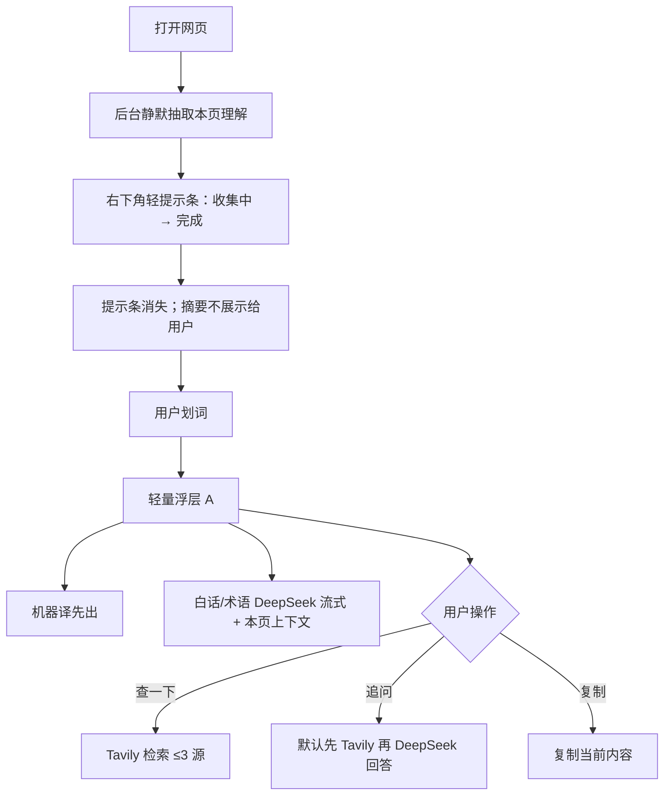

# 阅读 Agent · 第一版交互说明

> **状态**：已确认（2026-10-30）  
> **仓库**：mei-translate（Mei Lingua）  
> **范围**：产品 / 交互定稿；本文档不包含实现代码。

## 1. 产品定位

在现有 Chrome 扩展翻译能力之上，把主价值从「译」转向「懂」，同时保留翻译为一栏。

| 已有能力（保留） | 本版新增 |
| --- | --- |
| 划词翻译、整页翻译、PDF、双译 | 进页静默整页理解（后台上下文） |
| 多模型配置、TTS、站点黑名单等 | 划词浮层：白话 / 术语解释 |
| Cloudflare Workers / Hono / D1 / KV | 按需「查一下」（Tavily）与默认可联网「追问」 |

**领域**：可自动猜测（技术 / 新闻 / 金融等）；猜不准时走通用理解。

**人设对齐**：公开叙事偏 Node 全栈 + Agent；本功能强调「帮用户读懂网页」，翻译仍是基础层。

## 2. 总流程

## 3. 进页：静默整页理解

### 3.1 行为

1. 用户打开网页后，扩展在后台静默抽取本页理解素材（至少包含：标题、大纲、首屏 / 首视区内容）。
2. 右下角出现**轻提示条**，仅表示进度：`收集中` → `完成`。
3. 收集完成后，提示条**自动消失**。
4. 生成的本页摘要**不对用户展示**，用户无法打开或查看摘要正文。
5. 摘要仅作为后台上下文，供后续划词白话解释与追问使用。

### 3.2 提示条约束

- 位置：右下角。
- 仅作状态提示，**本身不可点击、不可展开**。
- 不承载摘要内容，不提供「查看本页理解」入口。

### 3.3 失败与降级（建议）

- 抽取失败时：提示条可短暂显示失败后消失，或不打扰用户；划词白话退化为无整页上下文的通用解释。
- 具体文案与重试策略实现阶段再定，但不得为此增加「可查看摘要」的 UI。

## 4. 划词浮层（主交互 A：轻量浮层）

选中页面文字后弹出轻量浮层，自上而下排布：

| 顺序 | 区块 | 说明 |
| --- | --- | --- |
| ① | 原文 | 可折叠 |
| ② | 机器译 | 优先出现 / 先流式或先返回 |
| ③ | 白话 / 术语 | DeepSeek 流式；带本页后台上下文；解释选中内容含义、术语、在本页中的作用等 |
| ④ | 联网区 | 默认空；用户点「查一下」后才填入 |
| ⑤ | 底部操作 | `复制` · `查一下` · `追问` |

原则：

- 主交互是轻量浮层，**不是**侧边抽屉。
- 翻译仍保留为一栏（机器译），白话是「懂」的主表达。
- 联网内容不抢在翻译 / 白话之前，也不自动触发。

## 5. 「查一下」（按需联网检索）

| 项 | 约定 |
| --- | --- |
| 触发 | 用户主动点击一次才搜索；不在每次划词时自动搜 |
| 检索 | Tavily；经 Cloudflare Workers 后端调用 |
| 密钥 | 放在 Workers 侧，不进扩展前端 |
| 展示 | 最多 **3** 条来源（标题 + 域名）+ 一段补充说明 |
| 再次点击 | 可刷新结果 |
| 失败 | 一行红字 + 重试；**不遮挡、不阻断**机器译与白话 |

## 6. 「追问」

| 项 | 约定 |
| --- | --- |
| 入口 | 浮层底部输入 |
| 默认 | **联网开启**（提问时先 Tavily，再 DeepSeek 回答） |
| 可关 | 浮层内可关掉联网，仅用本页上下文 + 模型回答 |
| 呈现 | 回答流式追加在白话区块下方，并标明「基于选中内容」 |

## 7. 本版明确不做

- 以侧边抽屉作为主交互。
- 每次划词自动联网检索。
- 把本页摘要展示给用户（含可展开提示条、摘要面板、历史摘要页等）。

## 8. 技术备注（仅供实现参考，本文不改代码）

| 能力 | 建议实现 |
| --- | --- |
| 白话 / 术语 / 追问生成 | DeepSeek 流式 |
| 联网检索 | Tavily（查一下：按需；追问：默认开、可关） |
| 后端 | 沿用现有 Cloudflare Workers / Hono 模式 |
| 密钥 | Workers 环境变量 / Secrets；扩展不落明文密钥 |

## 9. 与现有功能的关系

以下能力本版**保持不变**：

- 整页翻译
- PDF 翻译 / 对照
- 双译（机器 + AI）
- 多模型与用户自备 Key 的配置方式
- 现有快捷键、黑名单、TTS 等（除非后续单独改）

本版只在「进页理解 + 划词懂网页」路径上增加约定交互；不要求一次性重做整个产品。

## 10. 验收清单（交互）

- [ ] 进页有右下角轻提示，完成后消失，且提示条不可点
- [ ] 用户无法查看本页摘要正文；划词白话仍能用到后台上下文
- [ ] 划词浮层顺序为：原文 → 机器译 → 白话 → 联网区 → 底部三按钮
- [ ] 「查一下」点一次才搜；最多 3 条来源 + 补充；失败红字可重试且不挡译/白话
- [ ] 「追问」默认联网、可关；回答在白话下、标基于选中内容
- [ ] 无侧栏主交互、无自动每次划词联网、无摘要展示 UI

---

*文档确认日期：2026-10-30（Asia/Shanghai）。变更请先改本文再实现。*
